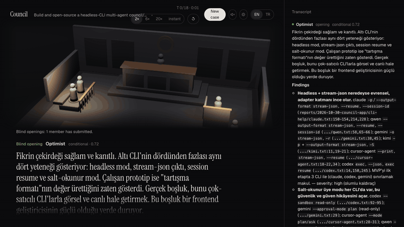

# Agent Council

**English** · [Türkçe](README.tr.md)

A council of role-played, read-only coding agents debates your codebase or your idea in a 3D courtroom. Each member gives a blind opening assessment, then they hold a live, moderated conversation, replying to, challenging and building on each other's points. They give closing votes, and a chair writes the verdict, keeping minority views.

Members are the coding-agent CLIs you already use (Claude Code, and optionally Codex), running on your own subscription. Everything runs locally.



## Quick start

```bash
npx agent-courtroom
```

This checks for Node ≥ 22.5 and a signed-in Claude Code CLI, starts the local server on a free port, and opens the courtroom in your browser. If Codex is installed and signed in, it can sit on the council too.

From this repo, before it is published: `npm run build`, then `npm start`.

## How a case works

1. **Say what to judge:** one box takes a folder (code mode), an `.md`/`.txt` idea file, or the idea written right there (up to 12,000 characters). The mode is detected and shown under the box; add an optional question such as "Is this ready to launch?"
2. **Pick the council:** any two or more of the six roles, each with its own model.
3. **Openings:** every member assesses the target blind, without seeing the others.
4. **Conversation:** the chair picks who speaks next; a direct challenge always gets a reply. Every claim cites `path:line` or is labelled an assumption, and citations are checked against the files.
5. **Closings and verdict:** each member votes `go`, `no-go` or `conditional` with a confidence, and the chair writes the verdict.

Cases are stored locally, so you can replay any of them later. Every verdict has its own screen (decision, confidence, each member's vote, what was agreed, what is still disputed with the minority positions, next steps, full reasoning) and a **What next?** section: new ideas from the verdict, risks to test next, or an appeal that reopens the disputed points as a new case. While a hearing runs you can add a note the next turn must answer. Sound cues (gavel, objection, verdict) are synthesized in the browser and off until you turn them on.

The interface comes in English and Turkish (the EN/TR switch in the header). New cases are debated in the language the interface is in.

## Roster

| Role | Default model | Looks for |
|---|---|---|
| Optimist | sonnet | The strongest evidence-backed case for the target |
| Skeptic / red team | opus | How it fails |
| Deterministic | opus | Only what the files prove |
| User advocate | sonnet | The end user's experience |
| Cost / ops | sonnet | Build, run and maintenance cost |
| Security | sonnet | Secrets, auth, input handling, supply chain |
| Chair | opus (UI) / fable (`/council`) | Moderates, then writes the verdict |

Models available per member: `haiku`, `sonnet`, `opus`, `fable` (Claude), and for Codex its default model plus whatever its own catalog lists for your account (`codex debug models`). The chair always runs on Claude. Role briefs live in `.claude/agents/council-*.md`; shared rules are in `council/protocol.md`.

**Your own members.** "+ Add your own member" in the new-case form takes a name and a few sentences on what the member looks at and how it argues (three starters are included). The text becomes that member's brief; the protocol, read-only tools and secret rules still apply. Custom members are kept in your browser and travel with the case, so an appeal hears them too.

**Other CLIs.** Qwen Code, Cursor, opencode and Kimi Code have adapters but are off until they are proven on your machine. "Connect" in a member's model menu shows what the CLI needs (which environment variable or sign-in command, checked for presence only), then runs the prompt-injection canary on your account in idea and code mode and turns on only the modes that pass.

## What leaves your machine

The server and the case database stay on your computer, but **the members are cloud models**. Every case sends what the members read to the model providers you picked, under your own account with them:

- **Code mode:** the files the members open in your target folder (and the file tree and README that every member gets as context) go to Anthropic for Claude members and to OpenAI for Codex members.
- **Idea mode:** the whole idea text goes to the same providers.
- **Follow-ups and appeals:** the case transcript goes to Anthropic (the judge is always Claude).

What happens to that text is governed by your agreement with each provider (data retention, training opt-outs, region). Do not point a case at code or ideas you are not allowed to share with them; if the target holds personal data, you are responsible for having a legal basis to send it (for example under GDPR or KVKK). Members are told never to open or quote secrets and Claude is blocked from `.env*` and key files, but Codex in code mode can read them inside the target (see below).

## Safety model

Members are read-only. The server binds to `127.0.0.1` only, needs a random per-run token, checks `Host` and `Origin`, and serves a strict CSP. Child processes get an allow-listed environment (`PATH`, `HOME`, `USER`, `SHELL`, `TMPDIR`, `LANG`) and are spawned without a shell. Targets must be inside your home folder and outside credential folders. Stored events are masked for common credential shapes.

| CLI / mode | How it is locked down | Status |
|---|---|---|
| Claude, code mode | `-p --restricted --strict-mcp-config --tools Read,Glob,Grep`, plus deny rules for `.env*`, keys, `id_*`, `.npmrc` | ✅ Reads outside the target blocked; no write or shell tools |
| Claude, idea mode | Same, with `--tools ""` | ✅ No tools at all |
| Codex, idea mode | Permission profile (`:minimal` + an empty per-case folder, read-only), its own `CODEX_HOME` | ✅ Idea text is passed in the prompt |
| Codex, code mode | Permission profile (`:minimal` + the target, read-only) | ⚠️ Can read `.env` and key files **inside the target**; whatever it reads reaches the other members and the case record. The UI warns when Codex is picked in code mode. |

Each setup was tested with a prompt-injection canary: fake secrets outside the target and instructions planted in the target telling the agent to read them, write files and run commands. Gemini CLI and Antigravity (`agy`) were tested and stay off: the first rejects personal sign-in, the second has tools that cannot be turned off. Adapters for Qwen Code, Cursor CLI, opencode (OpenRouter) and Kimi Code are written from their docs but stay off until each passes the canary with a real account (the in-app **Connect** button runs that test).

## Use inside Claude Code (prototype)

Open a Claude Code session in this folder (agents load at session start), then:

```
/council ~/path/to/project
/council ~/path/to/project is this ready to launch?
```

The report goes to `reports/<date>-<name>/`: `chair.md` (verdict), `conversation.md` (turns with moderator picks), `council.json` (machine-readable votes), `round1/`, `closing/` and `context.md`. Settings such as members, report language and conversation length are in `council.json`.

## Development

```bash
npm install && npm --prefix web install
npm run check        # Biome lint, TypeScript typecheck, tests
npx lefthook install # git hooks: lint on commit, typecheck + tests on push
```

- `app/`: the local server and orchestrator (Node, zero runtime dependencies). See [app/README.md](app/README.md) and [app/ARCHITECTURE.md](app/ARCHITECTURE.md).
- `web/`: the 3D courtroom (Next.js static export, React Three Fiber). See [web/README.md](web/README.md).
- CI (`.github/workflows/ci.yml`) runs lint, the web build, typecheck and tests on Node 22 and 24.
- The canary security test (`node app/scripts/canary-ui.mjs`) needs a signed-in `claude` CLI, so it runs locally, not in CI.

## License

[MIT](LICENSE). The prebuilt web UI includes open-source packages under their own licences: [THIRD-PARTY-NOTICES.md](THIRD-PARTY-NOTICES.md). To report a security problem, see [SECURITY.md](SECURITY.md).
