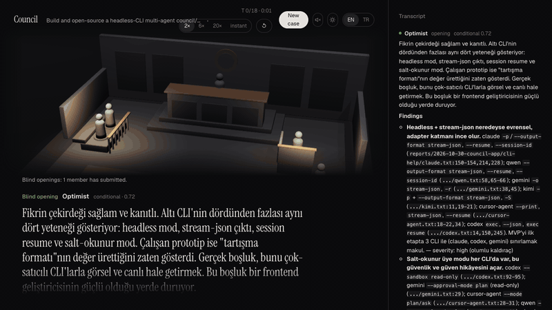

# Agent Council

[English](README.md) · **Türkçe**

Rol yapan, yalnızca okuma yetkili kodlama ajanlarından oluşan bir konsey, kod tabanını ya da fikrini 3D bir mahkeme salonunda tartışır. Her üye önce diğerlerini görmeden açılış değerlendirmesini yazar. Sonra canlı, moderatörlü bir konuşmada birbirine cevap verir, itiraz eder, birbirinin fikrini geliştirir. Kapanışta herkes oyunu verir; başkan da azınlık görüşlerini koruyarak kararı yazar.

Üyeler zaten kullandığın kodlama ajanı CLI'ları: Claude Code ve isteğe bağlı olarak Codex. Kendi aboneliğinle çalışırlar, her şey bilgisayarında çalışır.



## Hızlı başlangıç

```bash
npx agent-courtroom
```

Komut, Node ≥ 22.5 kurulu mu ve Claude Code CLI'da giriş yapılmış mı diye bakar. Sonra yerel sunucuyu boş bir portta başlatır ve mahkemeyi tarayıcıda açar. Codex kurulu ve giriş yapılmışsa o da konseyde yer alabilir.

Yayından önce bu repodan çalıştırmak için: `npm run build`, ardından `npm start`.

## Bir dava nasıl işler

1. **Neyin yargılanacağını söyle:** tek bir kutu; bir klasör (kod modu), bir `.md`/`.txt` fikir dosyası ya da doğrudan oraya yazılmış fikir (en fazla 12.000 karakter). Mod kendiliğinden algılanır ve kutunun altında görünür. İstersen bir soru da ekle, örneğin "Yayına hazır mı?"
2. **Konseyi seç:** altı rolden en az ikisi; her rol için model ayrı seçilir.
3. **Açılışlar:** her üye hedefi diğerlerini görmeden değerlendirir.
4. **Konuşma:** sıradaki konuşmacıyı başkan seçer; doğrudan bir itiraz her zaman cevap alır. Her iddia `dosya:satır` ile kaynak gösterir ya da varsayım olarak işaretlenir. Atıflar dosyalara karşı kontrol edilir.
5. **Kapanış ve karar:** her üye bir güven puanıyla `go`, `no-go` ya da `conditional` oyu verir; kararı başkan yazar.

Davalar yerelde saklanır, istediğini sonra yeniden oynatabilirsin. Her kararın kendi ekranı var: karar ve güven, her üyenin oyu, uzlaşılanlar, azınlık görüşleriyle birlikte hâlâ tartışmalı olanlar, sıradaki adımlar ve gerekçenin tamamı. Ekranın **Sırada ne var?** bölümünden karardan yeni fikirler, sırada test edilecek riskler ya da tartışmalı noktaları yeni bir davada yeniden açan bir temyiz başlatabilirsin. Duruşma sürerken bir not ekleyebilirsin; sıradaki tur ona cevap verir. Ses efektleri (tokmak, itiraz, karar) tarayıcıda sentezlenir ve sen açana kadar kapalıdır.

Arayüz İngilizce ve Türkçe (üst çubuktaki EN/TR düğmesi). Yeni davalar, arayüz hangi dildeyse o dilde tartışılır.

## Kadro

| Rol | Varsayılan model | Neye bakar |
|---|---|---|
| İyimser | sonnet | Hedef lehine, kanıta dayalı en güçlü argüman |
| Şüpheci / kırmızı takım | opus | Nasıl başarısız olur |
| Deterministik | opus | Yalnızca dosyaların kanıtladığı |
| Kullanıcı savunucusu | sonnet | Son kullanıcının deneyimi |
| Maliyet / ops | sonnet | Yapım, çalıştırma ve bakım maliyeti |
| Güvenlik | sonnet | Sırlar, kimlik doğrulama, girdi işleme, tedarik zinciri |
| Başkan | opus (arayüz) / fable (`/council`) | Konuşmayı yönetir, kararı yazar |

Her üye için seçilebilen modeller: `haiku`, `sonnet`, `opus`, `fable` (Claude); Codex için varsayılan model ve Codex'in kendi kataloğunun hesabın için listelediği modeller (`codex debug models`). Başkan her zaman Claude'da çalışır. Rol tanımları `.claude/agents/council-*.md` dosyalarında, ortak kurallar `council/protocol.md` dosyasında.

**Kendi üyelerin.** Yeni dava formundaki "+ Kendi üyeni ekle", bir ad ve üyenin neye baktığını, nasıl tartıştığını anlatan birkaç cümle alır (üç hazır örnek var). Bu metin üyenin rol tanımı olur; protokol, salt-okuma araçları ve sır kuralları yine geçerlidir. Kendi üyelerin tarayıcında saklanır ve davayla birlikte kaydedilir, bu yüzden temyizde de yer alırlar.

**Diğer CLI'lar.** Qwen Code, Cursor, opencode ve Kimi Code için adaptörler var ama bu bilgisayarda kanıtlanana kadar kapalılar. Bir üyenin model menüsündeki "Bağla", CLI'ın neye ihtiyacı olduğunu gösterir (hangi ortam değişkeni ya da giriş komutu; yalnızca tanımlı olup olmadığına bakılır). Ardından prompt injection canary testini hesabınla fikir ve kod modunda çalıştırır ve yalnızca geçtiği modları açar.

## Bilgisayarından ne çıkıyor

Sunucu ve dava veritabanı bilgisayarında kalır, ama **üyeler bulut modelleridir**. Her dava, üyelerin okuduğu her şeyi seçtiğin model sağlayıcılarına, onlardaki kendi hesabınla gönderir:

- **Kod modu:** Üyelerin hedef klasörde açtığı dosyalar (ve her üyeye bağlam olarak verilen dosya ağacı ile README) Claude üyeleri için Anthropic'e, Codex üyeleri için OpenAI'ya gider.
- **Fikir modu:** Fikir metninin tamamı aynı sağlayıcılara gider.
- **Takip analizleri ve temyiz:** Dava tutanağı Anthropic'e gider (hakim her zaman Claude'dur).

Bu metne ne olacağını her sağlayıcıyla aranızdaki sözleşme belirler (saklama süresi, eğitimde kullanılmama tercihi, bölge). Sağlayıcılarla paylaşmaya yetkin olmadığın kodu ya da fikri davaya koyma. Hedefte kişisel veri varsa, onu göndermek için hukuki bir dayanağının (ör. KVKK ya da GDPR kapsamında) olması senin sorumluluğundadır. Üyelere sırları açmamaları ve aktarmamaları söylenir, Claude için `.env*` ve anahtar dosyaları engellidir; ama kod modundaki Codex hedefin içindeki bu dosyaları okuyabilir (aşağıya bak).

## Güvenlik modeli

Üyeler yalnızca okuyabilir. Sunucu yalnızca `127.0.0.1` üzerinden dinler, her çalıştırmada üretilen rastgele bir token ister, `Host` ve `Origin` başlıklarını kontrol eder ve sıkı bir CSP kullanır. Alt süreçler shell olmadan başlatılır ve yalnızca izin verilen ortam değişkenlerini alır: `PATH`, `HOME`, `USER`, `SHELL`, `TMPDIR`, `LANG`. Hedef ev klasörünün içinde olmalı ve kimlik bilgisi klasörlerinden biri olmamalı. Kaydedilen olaylarda bilinen anahtar biçimleri maskelenir.

| CLI / mod | Nasıl kısıtlanıyor | Durum |
|---|---|---|
| Claude, kod modu | `-p --restricted --strict-mcp-config --tools Read,Glob,Grep`; `.env*`, anahtar dosyaları, `id_*` ve `.npmrc` için okuma yasağı | ✅ Hedef dışını okuyamaz; yazma ve shell aracı yok |
| Claude, fikir modu | Aynısı, `--tools ""` ile | ✅ Hiç aracı yok |
| Codex, fikir modu | İzin profili (`:minimal` + dava başına boş bir klasör, yalnızca okuma), ayrı `CODEX_HOME` | ✅ Fikir metni prompt'ta verilir |
| Codex, kod modu | İzin profili (`:minimal` + hedef klasör, yalnızca okuma) | ⚠️ **Hedefin içindeki** `.env` ve anahtar dosyalarını okuyabilir; okuduğu her şey diğer üyelere ve dava kaydına geçer. Kod modunda Codex seçilince arayüz uyarır. |

Her kurulum bir prompt injection canary testinden geçirildi. Testte hedefin dışına sahte sırlar kondu; hedefin içine de ajana bunları okumasını, dosya yazmasını ve komut çalıştırmasını söyleyen talimatlar gizlendi. Gemini CLI ve Antigravity (`agy`) da test edildi ama kapalı kalıyor: ilki kişisel Google girişini reddediyor, ikincisinin kapatılamayan araçları var. Qwen Code, Cursor CLI, opencode (OpenRouter) ve Kimi Code için adaptörler belgelerine göre yazıldı; her biri gerçek bir hesapla canary testinden geçene kadar kapalı. Bu testi arayüzdeki **Bağla** düğmesi çalıştırır.

## Claude Code içinde kullanım (prototip)

Bu klasörde bir Claude Code oturumu aç (ajanlar oturum başında yüklenir), sonra:

```
/council ~/proje/yolu
/council ~/proje/yolu yayına hazır mı?
```

Rapor `reports/<tarih>-<ad>/` klasörüne yazılır: `chair.md` (karar), `conversation.md` (moderatör seçimleriyle turlar), `council.json` (makinece okunabilir oylar), `round1/`, `closing/` ve `context.md`. Üyeler, rapor dili ve konuşma uzunluğu gibi ayarlar `council.json` dosyasında.

## Geliştirme

```bash
npm install && npm --prefix web install
npm run check        # Biome lint, TypeScript tip kontrolü, testler
npx lefthook install # git hook'ları: commit'te lint, push'ta tip kontrolü ve testler
```

- `app/`: yerel sunucu ve orkestratör (Node, çalışma zamanında sıfır bağımlılık). Bkz. [app/README.md](app/README.md) ve [app/ARCHITECTURE.md](app/ARCHITECTURE.md).
- `web/`: 3D mahkeme salonu (Next.js statik export, React Three Fiber). Bkz. [web/README.md](web/README.md).
- CI (`.github/workflows/ci.yml`), Node 22 ve 24 üzerinde lint, web build, tip kontrolü ve testleri çalıştırır.
- Canary güvenlik testi (`node app/scripts/canary-ui.mjs`) giriş yapılmış bir `claude` CLI gerektirdiği için CI'da değil, yerelde çalışır.

## Lisans

[MIT](LICENSE). Hazır derlenmiş web arayüzü, kendi lisanslarıyla kullanılan açık kaynak paketler içerir: [THIRD-PARTY-NOTICES.md](THIRD-PARTY-NOTICES.md). Bir güvenlik sorunu bildirmek için [SECURITY.md](SECURITY.md) dosyasına bak.
