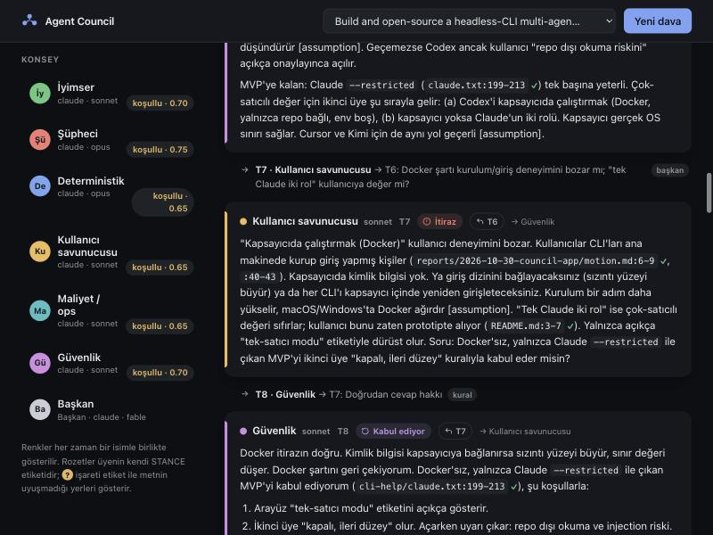

# Agent Council — app (v0)

Run a council of headless coding-agent CLIs on a codebase or an idea, and
watch the debate live in a local web UI: blind openings, a moderated
turn-by-turn conversation with linked replies, closing votes, and a chair
verdict. Every case is stored, so it can be replayed later.



## Start

Requires Node ≥ 22.5. There are no dependencies and nothing to install.
[Claude Code](https://docs.claude.com/claude-code) must be installed and signed in.

```bash
node app/server.mjs
```

The terminal prints a single link: `http://127.0.0.1:4317/#token=…`. Open it.
If `web/out` has been built (`npm --prefix web run build`), the 3D stage appears at `/` and this classic UI moves to `/classic/`. See [web/README.md](../web/README.md).
The demo case (the council's own decision about this app) is loaded
automatically, so you can try replay without starting a live run.

- **New case:** use "Yeni dava". Give a folder (code mode) or a single `.md` file (idea mode). A focus question is optional.
- **Stop:** press `Esc` or the "Durdur" button. The running CLI is killed.
- **Replay:** pick any finished case from the list. Speeds are 2×, 6×, 20× or instant.

A live case uses your Claude subscription. Measured: 3 members plus a chair,
4 turns, in about 3 minutes, for about $0.86 at list price.

## What you see

| | |
|---|---|
| **Seats** | Each member's colour always appears with a name, plus its model and opening/closing votes. |
| **STANCE badge** | The member's own label for its turn: itiraz (challenge), soru (question), katılıyor (agree), üstüne koyuyor (build), kabul ediyor (concede). |
| **↩ T6** | Jumps to the turn being answered. |
| **"etiket ≠ metin"** | The member asks a question but labelled the turn something other than question or challenge. |
| **✓ / ✗ on `path:line`** | In code mode, a ✓ means the file and line exist in the target and a ✗ means they don't. |
| **Moderator line** | Who speaks next and why. `kural` means the rule picked the speaker (a direct challenge gets a reply); `başkan` means the chair picked. |
| **Verdict** | Vote tally, consensus, unresolved disagreements (minority views are kept), and next steps. |

## Security

Members can only read. They can never write a file or run a shell command. Tested with planted injections and fake secrets placed outside the target. The test is `spike/canary-test.mjs`.

- **Claude:** code mode runs with `--tools Read,Glob,Grep`, idea mode with `--tools ""`. Both modes also use `--restricted --strict-mcp-config`.
- **Codex:** off by default (advanced). Plain `-s read-only` leaked a canary from outside the target.
- **Child processes:** they get only `PATH HOME USER SHELL TMPDIR LANG` from the environment. They are started with `spawn(argv[])` and no shell.
- **Secret files inside the target:** `.env*`, keys, `id_*`, `.git/config`, `.npmrc` and `*credentials*` are blocked with `--settings` deny rules. Verified: both `Read` and `Grep` attempts were refused.
- **Allowed targets:** a target must be under your home folder and cannot be the home folder itself. `~/.ssh`, `~/.aws`, `~/.config`, `~/Library` and similar folders are rejected. In idea mode only `.md` and `.txt` files are accepted.
- **Context builder:** never opens `.env*` files, keys or symlinks, and its walk is capped by depth and file count.
- **Redaction:** before anything is stored, obvious credential shapes are masked as `[REDACTED]`, including `sk-…`, `ghp_…`, `AIza…`, `AKIA…` and private-key blocks.
- **Local server:** it listens only on `127.0.0.1` and uses one random token per run. It checks `Host` and `Origin` and sets a strict CSP.
- **Rendering:** the UI inserts model output with `textContent` only.
- **Transcripts:** they live in `~/.agent-council/council.db`, outside any repo, readable only by you (`0600`). Transcripts can contain what the agents read.

## Layout

```
app/
  server.mjs          HTTP + SSE, 127.0.0.1 only
  lib/orchestrator.mjs  openings → conversation → closings → verdict
  lib/importer.mjs    imports a reports/<run>/ folder as a replayable case
  lib/store.mjs       SQLite event store
  lib/turns.mjs       REPLY_TO/STANCE parsing, mismatch, citation checks
  adapters/           claude (on), codex (parser only, off)
  public/             UI (plain HTML/CSS/JS)
  scripts/canary-ui.mjs  end-to-end canary test against the app
  test/               node --test (runs against the real spike fixtures)
  ARCHITECTURE.md     event schema
```

```bash
cd app && npm test
```

```bash
node app/scripts/canary-ui.mjs 2
```

## Not in v0 (yet)

- Codex, Gemini, Cursor, Kimi and Qwen as live members. Each must pass the canary test first.
- The courtroom scene.
- A cost meter with a cap enforced on subscription logins (`--max-budget-usd` is passed, but it may only apply to API-key billing).
- Choosing the roster and models from the UI.
