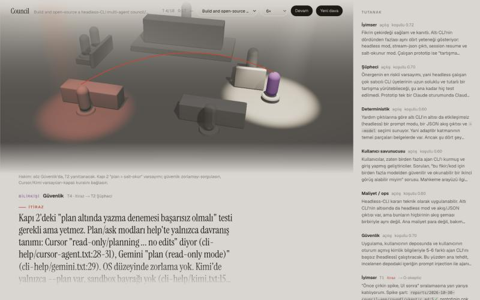
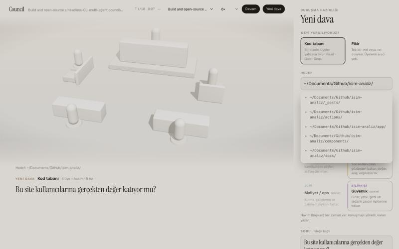

# Council: 3D stage

A scale-model courtroom lit like a stage. Light shows who has the floor:
- **Speaker:** stands in a beam, with the turn's text in large type below the scene.
- **Objection:** a red arc and a red pool of light on the member being challenged.
- **Verdict:** the house lights come up and every figure takes the colour of its vote.

The transcript on the right holds the same data and is the accessible record; the canvas itself is `aria-hidden`.

Screenshots are in [docs/](docs/).



## New case

"Yeni dava" turns the transcript column into a case-preparation panel, and the stage previews the room as you choose:
- Code or idea mode.
- The target, with folder suggestions limited to your home folder.
- The council: 2–6 roles picked as chips, each with its own model (haiku, sonnet, opus or fable); the judge is always present and also has a model menu. The server accepts only these four aliases and falls back to the role's default for anything else.
- The question, shown in large type on the stage.
- The turn count, with an estimated duration.

Members run on your Claude subscription (the `claude` CLI login), so no dollar figure is shown.



## Run

```bash
npx agent-courtroom
```

From a checkout:

```bash
npm run build
```

```bash
npm start
```

## Build and run (manual)

Next.js 16, React Three Fiber 9, drei 10 and three 0.187. The app is exported as static files, and the zero-dependency Node server in `../app` serves them.

```bash
npm --prefix web install
```

```bash
npm --prefix web run build
```

```bash
node app/server.mjs
```

Open the link the server prints (`http://127.0.0.1:4317/#token=…`). The 3D stage is at `/`; the classic UI is at `/classic/`.

## Develop

Run the API with the dev origin allowed, then start Next dev pointed at it:

```bash
COUNCIL_ALLOWED_ORIGINS=http://localhost:3130 node app/server.mjs
```

```bash
NEXT_PUBLIC_COUNCIL_API=http://127.0.0.1:4317 npm --prefix web run dev
```

Open `http://localhost:3130/#token=<token from the server>`.

## Notes

- **Data:** the stage uses the same SSE stream and REST API as the classic UI (`app/ARCHITECTURE.md`). Nothing new on the server except static serving and the dev CORS allowlist.
- **CSP:** the server adds the SHA-256 hashes of the exported page's inline scripts to `script-src`. There is no `unsafe-inline`.
- **Pause a replay:** `?case=<id>&upto=7` stops the replay after turn 7, and "Devam" continues it.
- **Fallback:** if WebGL is unavailable or the scene throws, the stage is replaced with a note; the text band and the transcript keep working.
- **Reduced motion:** with `prefers-reduced-motion`, the camera holds still.

## Performance

Measured with `node web/scripts/perf.mjs "<url with #token=…>" <caseId>`: headless Chrome replays a case at 2× and records 10 s of frames. Measured 2026-10-31 on an Apple M4 Pro, replaying a 2-turn, 6-member case after the maquette rework (walls, dais, rails, figurines, generated studio lighting):

| Profile | Average fps | p99 frame | Frames > 50 ms | Long tasks while playing | JS heap |
|---|---|---|---|---|---|
| Desktop 1440×900 @2x | 60 | 16.8 ms | 0 | 0 | 20 MB |
| Phone 375×812 @3x, CPU 4× slower | 60 | 16.8 ms | 0 | 0 | 24 MB |

At load the desktop has two tasks of 66–74 ms; the throttled phone has five of 64–194 ms (scene setup, shader and shadow compiles), up from two or three before the rework. The phone profile throttles the CPU only, not the GPU, so a real low-end phone will do worse than this; the canvas is capped at 2× device pixel ratio.

Layout check: `node web/scripts/shots.mjs "<url with #token=…>" <caseId> <outDir>` saves phone (375 px) and desktop screenshots of a debate, the verdict and the new-case form, and reports any element wider than the viewport.

States: `node web/scripts/states.mjs <outDir> [en|tr]` photographs every non-happy-path screen (loading, waiting, stopped, failed, verdict, follow-ups) against its own server with a slow scripted `claude`.

Sounds: `node web/scripts/sounds.mjs <outDir>` renders each cue from `web/lib/sound.ts` to a WAV file and prints its peak and RMS level, so the cues can be listened to and checked for clipping outside the app. Measured 2026-10-31: gavel, objection and verdict peak near −15 dBFS, the tick near −24 dBFS; nothing clips.
